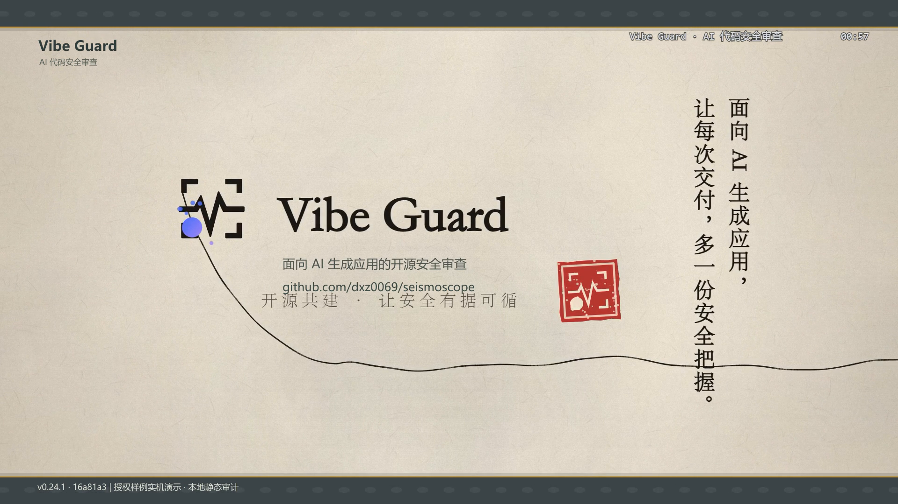

# Vibe Guard 宣传片

[观看宣传片](vibe-guard-promo-1080p60.mp4) · [下载中文字幕（SRT）](vibe-guard-promo.zh.srt) · [项目仓库](https://github.com/shangjian2023/vibe-guard)

## 成片规格

- 时长：59.25 秒。
- 画面：1920 × 1080，60 fps，H.264 编码。
- 音频：AAC，中文旁白与原创配乐混音。
- 字幕：独立 SRT 文件，时间码对应成片的实际时间轴。

## 拍摄版本

界面截图与录屏来自真实的 Vibe Guard UI，拍摄基线为当时的上游 v0.24.1，提交 `16a81a3826882cfe00b9c8fc392a2b9b2969d6ed`。

[上游拍摄版本的源码](https://github.com/dxz0069/seismoscope/tree/16a81a3826882cfe00b9c8fc392a2b9b2969d6ed)仅供技术溯源，宣传片的产品名称统一为 **Vibe Guard**。

本次发布只添加视频、封面、字幕及说明，刻意不升级本 fork 的 main，不合并或同步上游代码。发布所基于的 fork 提交为 `9ec5242d15d489a28e0463c8351872edc96e5e90`。因此，视频中的界面版本与本仓库现有代码版本可能不同，不应将实拍版本理解为本 fork 已完成升级。

## 演示数据与能力边界

截图与录屏使用本地授权测试样例（静态 fixtures），用于展示界面、审查信息和候选结果，不代表对生产系统进行过漏洞利用或动态验证。

本次样例在界面中展示：

| 项目 | 数量 |
| --- | ---: |
| 审查条目（finding） | 20 |
| 仅静态结果（`static_only`） | 8 |
| 待补充证据（`needs_evidence`） | 8 |
| 已拒绝条目（`rejected`） | 4 |
| 候选提案（proposal） | 16 |
| VRTM 节点 | 56 |
| VRTM 边 | 79 |
| VRTM 假设 | 5 |

`static_only`、`needs_evidence` 与 `rejected` 是这 20 条审查条目的状态划分。16 条 proposal 是候选提案，不等于 16 个已验证漏洞；VRTM 中的假设也不等于已证实的攻击链。

**本片不声称动态验证或自动复测已接通。** 候选结果、待补证据、整改建议等界面内容，不应被解读为已完成动态利用、自动修复或自动回归测试。

## 声音与视觉素材

- 中文旁白通过豆包 / 火山引擎官方 API 合成，使用 VolcTTS 2.0，音色为 `zh_male_ruyayichen_uranus_bigtts`。
- 配乐为本片原创音乐。
- 动态视觉使用已获授权的 MotionGit ink 2.6.6，仓库仅收录渲染后的成片与封面，不分发模板或原始素材。

本次媒体发布不包含模板源文件、素材包、生成与渲染脚本、API 密钥、请求日志或本地配置。
